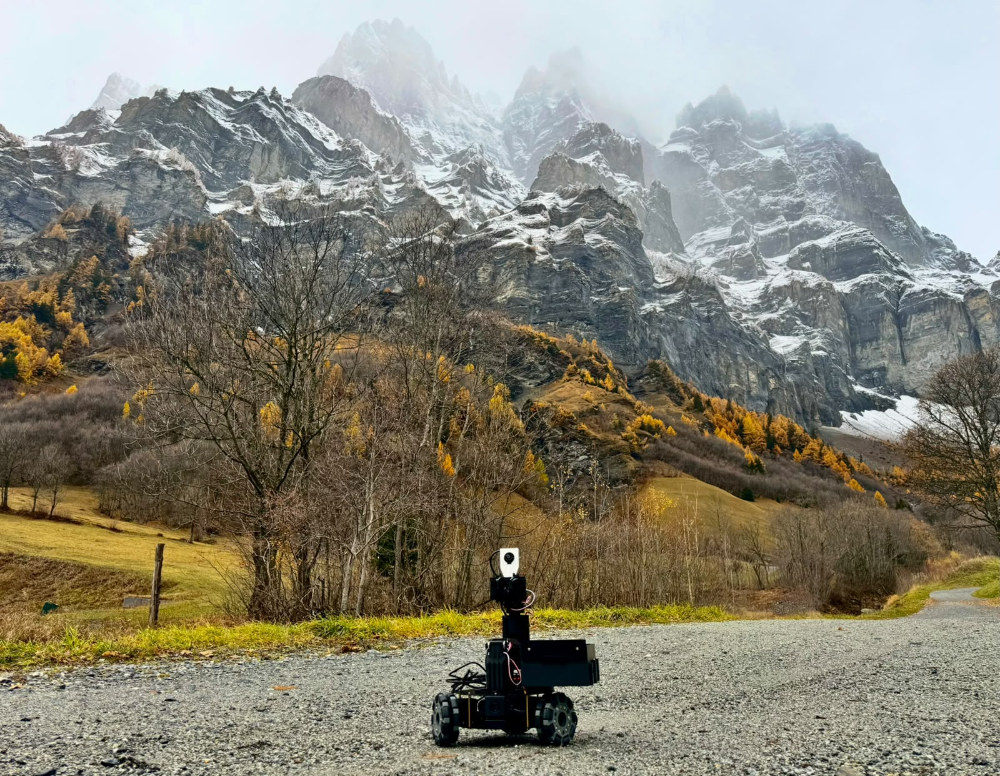

# Sisyphus

Sisyphus is a low-cost, modular mobile robot for repetitive indoor delivery work. At the 2026 Leukerbad Robotics Hackathon, its first delivery job was sorting the mail. The **Leukerbad Postman** prototype won both the **Autonomous Urban Services track** and the **overall Grand Final**.



## A letter from stack to mailbox

The demonstration started with a stack of addressed letters. Sisyphus picked up one letter, read the recipient’s name, identified the matching mailbox, drove to it and deposited the letter. It returned for the next letter and repeated the cycle until the stack was empty.

Three parts of the design make that job possible. The three-wheel Kiwi base can move sideways to line up with a mailbox. Camera-based optical character recognition (OCR) turns a printed name into a destination. A robotic arm and servo-driven dispenser handle the envelopes. The team designed the base around interchangeable tools and payloads, with medicine and tray delivery as possible future applications.

## Inside the repository

| Component | What you’ll find |
| --- | --- |
| [Robot and control station](ros2_robot/README.md) | ROS 2 Humble packages for the RDK X5 onboard computer and the operator’s PC. The robot controls the servos and camera. The PC hosts the web interface, RViz and arm planner. |
| [Recipient recognition](base_ocr/README.md) | Base-camera capture and name matching with PP-OCRv5 Mobile. An ambiguous reading returns an empty result so the caller can distinguish it from a match. |
| [Mapping and mailbox vision](slam/README.md) | Tools for mapping the indoor space, locating mailboxes and reading their labels. |
| [Arm planning](arm_control/README.md) | Inverse kinematics, trajectory timing and collision checks using the robot’s CAD geometry. |
| [MuJoCo simulation](digital_twin/README.md) | A digital twin for exercising navigation and arm motion without physical hardware. |

## Try the simulation

From the repository root on Linux, set up the digital twin and run its default mission.

```bash
bash digital_twin/setup.sh
bash digital_twin/run.sh --scenario mission
```

The supplied scene contains six mailboxes and zero letters, so this command runs a navigation tour. Add `--viewer` to watch it in an OpenGL session. The [digital twin guide](digital_twin/README.md) describes the other scenarios and the model’s calibration limits.

For the physical robot, start with the [deployment instructions](ros2_robot/README.md). The [ROS 2 architecture guide](docs/ROS2_MIGRATION.md) covers supervision and operation, the [PC restoration guide](docs/RESTORE_PC.md) lists pinned dependencies and saved robot data, and the [hardware notes](RDK-TROUBLESHOOTING.md) document servo IDs and Ethernet troubleshooting.

## Team

Evan Ayoub, Balthazar Bolze, Jérôme Courdacy, Vincent Lellu, Martin Mayer and Elias Pajot built Sisyphus for the Leukerbad Robotics Hackathon.


Thank you to the Edelweiss Innovation & Intelligence Institute (EIII), Pedro Jinjun Dong and EuroTech Federation for organizing the event.
