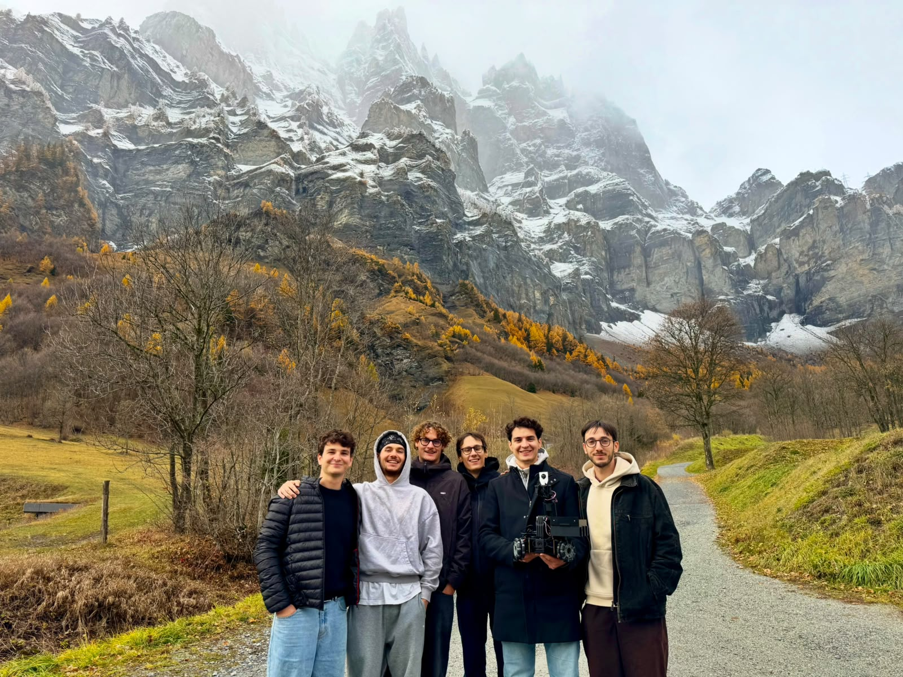

# Sisyphus

> **Built in 48 hours at the 2026 Leukerbad Robotics Hackathon**
>
> - **1st place in the Autonomous Urban Services track**
> - **1st place overall in the Grand Final**

Sisyphus is a low-cost, modular mobile robot for repetitive indoor delivery. Its first use case, **Leukerbad Postman**, autonomously sorted and delivered a stack of letters.

**Hackathon demo** · 43 seconds, accelerated footage

https://github.com/user-attachments/assets/c52f17e7-a493-4970-ab95-ac7294413782

[Watch on Google Drive](https://drive.google.com/file/d/1YhX-ApkGoVzBIu0LkoBMFkHpJ2p-o1RC/view?usp=sharing)

*Project status — Hackathon prototype demonstrated in 2026. The team no longer has access to the robot. The code and design notes are available as a reference for future projects.*

## From stack to mailbox

The robot picked up a letter, read the recipient’s name with a camera, and matched it to a mailbox label. Its three-wheel omnidirectional base navigated to the mailbox and could move sideways to line up for delivery. The arm deposited the letter, then the robot repeated the process until the stack was empty.

~~~mermaid
flowchart LR
    Stack["Feed and pick a letter"] --> OCR["Read recipient name"]
    OCR --> Match["Match name to mailbox"]
    Match --> Drive["Navigate and align"]
    Drive --> Deliver["Deposit letter"]
    Deliver -->|More letters| Stack
~~~

The robot combines a Kiwi drive base, a robotic arm, cameras, and a servo-driven envelope dispenser. The modular design also explored interchangeable tools and payloads for tasks like delivering medicine or trays.

## Technical reference

| Component | What the repository contains |
| --- | --- |
| [Robot and control station](ros2_robot/README.md) | ROS 2 Humble runtime for the RDK X5 and PC-based control station with RViz, a web interface, and arm planning. |
| [Recipient recognition](base_ocr/README.md) | Base-camera capture and name matching using PP-OCRv5 Mobile. |
| [Mapping and mailbox vision](slam/README.md) | Indoor mapping, mailbox localization, and label reading. |
| [Arm planning](arm_control/README.md) | Inverse kinematics, trajectory timing, and collision checks using robot CAD. |
| [MuJoCo digital twin](digital_twin/README.md) | Simulation of navigation and arm motion. The default scene runs a navigation tour of six mailboxes. |

The [ROS 2 architecture guide](docs/ROS2_MIGRATION.md), [PC restoration notes](docs/RESTORE_PC.md), and [hardware troubleshooting notes](RDK-TROUBLESHOOTING.md) document the original development setup.

## Team

Evan Ayoub, Balthazar Bolze, Jérôme Courdacy, Vincent Lellu, Martin Mayer, and Elias Pajot built Sisyphus at the Leukerbad Robotics Hackathon.

Thank you to the Edelweiss Innovation & Intelligence Institute (EIII), Pedro Jinjun Dong, and EuroTech Federation for organizing the event.
