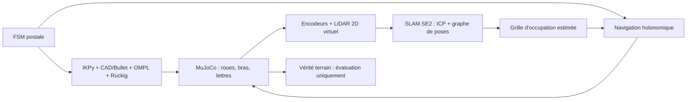

# Jumeau MuJoCo du robot facteur

Environnement exécutable de référence : **ElRobot 7+1 axes, base Kiwi à trois
roues omnidirectionnelles, châssis/sac issus du STEP fourni**, deux lettres,
deux boîtes aux lettres, obstacles et sol. Aucun client Station ni transport
vers le matériel n’est utilisé. La vision est absente de la boucle de contrôle.

Le modèle sert à vérifier les interfaces et le comportement logiciel. Le profil
par défaut est `nominal_unmeasured`, `hardware_verified=false` : masses de la
base, frottements, montage du CAD, support de lettres et paramètres de capteurs
doivent être identifiés pour prévoir les performances du robot réel.

## Lancer

Depuis la racine du dépôt, après checkout de la branche partagée :

```bash
bash digital_twin/setup.sh
bash digital_twin/run.sh --scenario mission
bash digital_twin/run.sh --scenario loop
bash digital_twin/run.sh --scenario dropout
```

La configuration livrée contient six boîtes et aucune lettre. Le scénario
`mission` bascule donc vers une tournée de navigation ; il ne démontre pas une
livraison de lettres dans cette configuration. Les murs font 20 cm, sous la
hauteur actuelle du LiDAR virtuel (23 cm au démarrage).

Pour faire bouger le bras avec le planificateur existant :

```bash
arm_control/.venv/bin/python -m digital_twin.arm_demo --viewer --repeat
```

Sans `--viewer --repeat`, la commande vérifie un cycle de trois cibles et écrit
son rapport dans `digital_twin/.runtime/`. Chaque collègue installe les
dépendances avec `setup.sh` ; les environnements, SDK et résultats locaux ne
sont pas versionnés.

La première construction décompose les solides CAD avec CoACD ; les résultats
restent dans `digital_twin/.runtime/`, ignoré par Git. Les scripts réutilisent
l’environnement Python local de `arm_control` et le SDK/URDF officiel téléchargé
par son installateur. Le moteur physique est MuJoCo 3.3.7, pas PyBullet ; ce
dernier reste le validateur du planificateur de bras existant.

Vue interactive (session graphique avec OpenGL) :

```bash
bash digital_twin/run.sh --scenario mission --viewer
```

Le viewer montre les géométries et permet de déplacer la caméra. Le mode sans
viewer avance aussi vite que le calcul le permet. `--realtime` le cadence au
temps réel. Pour une image sans écran, si EGL est disponible :

```bash
MUJOCO_GL=egl bash digital_twin/run.sh --scenario loop --snapshot /tmp/postal-twin.png
```

`--output CHEMIN` désigne un **nouveau** dossier de résultats. Il contient :
`report.json`, `trace.jsonl`, `config.json`, `map.npz`, `map.png`. L’image de carte
compare le trajet estimé (bleu) au trajet exact réservé à l’évaluation (vert).
Le rapport donne les transitions FSM, destinataires livrés, erreurs SLAM et
odométrie, fermetures de boucle, contacts, instabilités et dépassements de butées.

## Butées et actionneurs

Les sept intervalles articulaires viennent de l’URDF officiel ElRobot. Avec
`--arm-config arm_control/calibration-candidate.local.json`, un mapping vérifié
resserre ces intervalles à leur intersection avec les plages encodeur mesurées.
Un exemple non renseigné ne mesure pas les butées de votre exemplaire.

Ces limites sont présentes dans les joints MuJoCo et les consignes sont
validées. Une marge de commande de `0.03 rad` protège les extrémités ; la
cinématique inverse et les contrôles de position utilisent cette marge. MuJoCo
modélise les butées par contraintes souples, pas comme des contacts infiniment
rigides. Le test tolère au plus 0.002 rad d’écart numérique aux limites physiques.

Le couple du bras est borné à `2.94 N·m` selon l’URDF, la vitesse de consigne à
`0.15 rad/s` par défaut, avec les trajectoires Ruckig du projet. Les deux mâchoires
sont liées au moteur de pince par les rapports URDF `±0.0115 m/rad`. L’URDF donne
une inertie nulle à l’engrenage : un plancher d’inertie `1e-8 kg·m²` et une
armature moteur nominale `1e-4 kg·m²` permettent une dynamique bien conditionnée.
Les gains d’actionnement restent nominaux, sans identification du ST3215 réel.

## Base holonomique

Les trois moteurs entraînent de véritables roues avec rouleaux passifs articulés
(16 par roue). La base a un joint libre, subit la gravité et les contacts ; ses
positions/vitesses ne sont pas imposées à chaque pas. Le modèle peut déraper,
heurter un obstacle ou basculer. Les contacts rouleaux/sol sont normaux ; les
contacts du robot avec les obstacles ou ses autres parties sont rapportés.

La convention gauche/arrière/droite reprend la matrice du
[LeKiwi officiel LeRobot](https://github.com/huggingface/lerobot/blob/main/src/lerobot/robots/lekiwi/lekiwi.py).
Les angles de montage sont `[240, 0, 120]°`, avec un décalage de roulement de
`-90°`. Les rayons de référence sont 50 mm pour les roues et 125 mm entre le
centre du robot et les roues : ils sont **à mesurer sur votre montage**. Les
commandes sont `[vx, vy, omega]` en **m/s, m/s, rad/s**, avec saturation
proportionnelle des trois vitesses de roues. Aucune hypothèse différentielle
`vy=0` ni modèle Ackermann n’est utilisée.

Les rouleaux suivent le principe du modèle omnidirectionnel de
[MuJoCo Menagerie](https://github.com/google-deepmind/mujoco_menagerie/tree/main/robot_soccer_kit).
Les dimensions et propriétés inertielles de ce jumeau sont celles du profil
Kiwi configuré, pas celles du robot de football Menagerie.

## Chaîne sans vision



**Le LiDAR est un capteur virtuel de test. Sa présence sur le robot n’est pas
confirmée.** Il utilise les rayons MuJoCo, à 10 Hz, sur 181 directions, avec bruit
de 3 mm. Les encodeurs simulés donnent une odométrie X/Y/lacet avec erreurs
d’échelle et bruit configurables. Un gyroscope MuJoCo est exposé pour les
intégrations ; le SLAM de référence utilise seulement les roues et les distances.
Une position initiale connue au point de départ est supposée.

`RangeSlam` effectue un recalage point-ligne avec `scipy.spatial.cKDTree` et
`scipy.optimize.least_squares`, puis construit une carte probabiliste. Les
keyframes et fermetures de boucle alimentent un graphe SE(2) optimisé avec
le solveur sparse SciPy. Il ne reçoit ni pose exacte MuJoCo ni géométrie de la
pièce. Les tests retirent la géométrie du monde de sa configuration pour vérifier
ce contrat. Ce module est une référence pédagogique testée sur ces scénarios,
pas un remplacement validé de SLAM Toolbox en environnement réel.

La navigation réutilise `skimage.graph.route_through_array` pour la recherche
sur une grille gonflée à l’empreinte du robot. Le suivi commande X, Y et lacet
indépendamment, avec arrêt de proximité et arrêt sur distances périmées. Le
SLAM cartographie pendant le trajet ; une carte parfaite n’est pas fournie au
contrôleur. Les régions inconnues sont traversables à coût supérieur, sous
contrôle des distances locales. Cela ne constitue pas un explorateur de
frontières autonome pour un bâtiment entier.

## FSM et lettres

La FSM de référence suit : initialisation → prise → fermeture → position de
transport → navigation → accostage précis → approche/orientation → insertion
droite → ouverture → retrait → lettre suivante. La base reste asservie pendant
l’insertion. Les parois des boîtes et la lettre tenue sont intégrées au
planificateur du bras, dans le repère fourni par l’estimation SLAM.

Les destinataires et positions sémantiques de boîtes proviennent du scénario
JSON : ils remplacent la détection/OCR pour cette phase. La prise est une
**abstraction par contrainte soudée**, activable seulement si la pince est
fermée et le point de prise est à moins de 18 mm de la lettre. Elle ne valide
ni la force de pincement ni la séparation physique de plusieurs feuilles.
Les lettres restent mobiles physiquement après ouverture. Un dépôt doit
correspondre au destinataire et la lettre doit descendre dans le volume intérieur
de la boîte pour être confirmée. Ce retour simule un événement de confirmation
de dépôt ; aucun détecteur de dépôt réel n’est présumé disponible.

Le support et les points de prise sont des fixtures nominales configurables
(`pickup_joint_rad`, dimensions/pose de lettres). Le CAD du châssis/sac est
réutilisé en visuel et en décomposition convexe pour les contacts. Sa pose dans
`config.json` reste à recaler sur le montage réel. La cavité du sac est testée
pour éviter qu’une enveloppe convexe unique la ferme.

## Brancher vos modules

Aucune FSM/navigation/SLAM d’équipe n’a été trouvée dans cette branche au début
de cette mission. Deux interfaces sont fournies :

- Python : `--controller votre_module:VotreFSM` et `--slam votre_module:VotreSLAM`.
  La FSM est construite avec `(config, arm, pickup_q)` et fournit
  `update(observation, slam, feedback) -> (action, events)`, `state`, `error`,
  `finished`, `history`, `carry_q`, `close()`. Voir `task.py` pour les événements
  `grasp`, `release`, les retours de prise/dépôt, et le dictionnaire d’action.
  Un module SLAM fournit `update(observation)`, `pose`, `odometry_pose`, `map`,
  `quality`, `loop_closures`, `keyframes`, `healthy(time)`.
- ROS 2 : le pont décrit dans [ros/README.md](ros/README.md) expose commandes,
  capteurs et TF dans un espace de simulation isolé. Des profils holonomiques
  Nav2 et SLAM Toolbox sont fournis pour des modules ROS existants.

Le calcul synchrone des plans suspend le temps virtuel dans le runner Python.
Les rapports mesurent aussi le temps CPU ; ils ne valident pas des échéances
temps réel de l’ordinateur embarqué. Le pont ROS 2 est séparé de cette chaîne.

## Vérifier

```bash
OPENBLAS_NUM_THREADS=1 OMP_NUM_THREADS=1 arm_control/.venv/bin/python -m unittest \
  digital_twin.test_twin digital_twin.test_scenarios -v
```

Les tests couvrent butées, efforts, FK, pince mimic, cavité CAD, trois axes
holonomiques physiques, scans, interface Gymnasium, mission à deux lettres,
navigation avec retour et fermeture de boucle, et arrêt sur perte de LiDAR.
Les scénarios et les graines sont enregistrés. Les résultats ne certifient pas
le robot réel : capteurs, glissement, frottements, charge, montage et géométrie
des boîtes doivent être mesurés pour cette étape.

État de validation de la livraison : 10 tests sur 14 passent. Les quatre autres
reposent sur l'ancienne scène : prise d'une lettre absente, distances LiDAR
aux anciens murs, boucle à trois objectifs et livraison de deux lettres.
Ils doivent être adaptés avec des scènes de test dédiées ; cette suite ne
valide donc pas encore la scène actuelle dans son ensemble.
